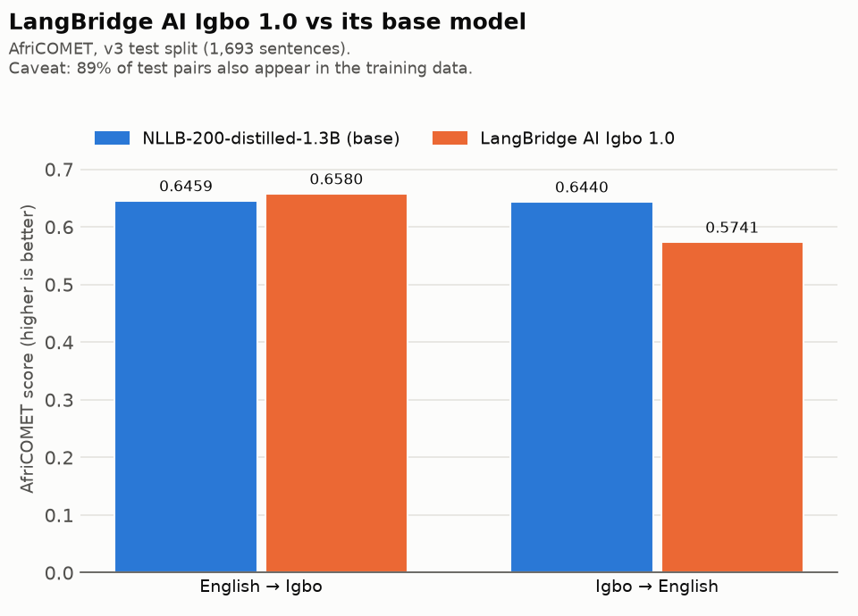

# LangBridge AI

**English → Igbo machine translation: a small QLoRA adapter for Meta's NLLB-200, built and evaluated on free GPUs.**

[](https://huggingface.co/coded-by-49/LANGBRIDGE_AI_IGBO_1.0)
[](https://huggingface.co/datasets/coded-by-49/langbridge_ai_v3_igbo_datasets)
[](LICENSE)
[](https://huggingface.co/facebook/nllb-200-distilled-1.3B)
[](pyproject.toml)
[](docs/deployment.md)

## What it does

LangBridge AI fine-tunes Meta's NLLB-200 translation model for Nigerian languages. The current release, **LangBridge AI Igbo 1.0** (internal: v3), translates **English → Igbo**. It is a LoRA adapter (a small set of extra weights) for `facebook/nllb-200-distilled-1.3B`. The other directions (Igbo → English, and Hausa and Yoruba ↔ English) are in progress.

## Results

AfriCOMET scores on the project's test split (1,693 sentences), checkpoint epoch 1.333666. AfriCOMET is a learned translation-quality metric for African languages; higher is better. Source: [`results/igbo1_vs_nllb1.3b.csv`](results/igbo1_vs_nllb1.3b.csv).

| Direction | NLLB-1.3B baseline | LangBridge AI Igbo 1.0 | Absolute change | Relative change |
|---|---|---|---|---|
| English → Igbo | 0.6459 | 0.6580 | +0.0122 | +1.88% |
| Igbo → English | 0.6440 | 0.5741 | −0.0699 | −10.86% |

The adapter was trained on English → Igbo only, and it is worse than the base model for Igbo → English. In production, Igbo → English and every other direction go to the base NLLB model ([routing plan](docs/deployment.md#routing-plan)).

> **Caveat:** 1,506 of the 1,693 test pairs (88.95%) also appear in the training data. This was found during an audit ([details](docs/evaluation.md#issue-4-test-split-overlaps-the-training-split)). So the English → Igbo gain is not yet a clean held-out result. Re-scoring on clean data is the next step.



## Project journey

The first version, **LangBridge v1** (NLLB-200-distilled-600M, six directions, millions of mixed-quality pairs), scored below its own base model. AfriCOMET, sentences 600–1600 ([`results/v1_vs_nllb600m.csv`](results/v1_vs_nllb600m.csv)):

| Direction | NLLB-600M | LangBridge v1 | Absolute change | Relative change |
|---|---|---|---|---|
| Igbo → English | 0.4029 | 0.3764 | −0.0264 | −6.57% |
| Hausa → English | 0.5205 | 0.2804 | −0.2401 | −46.13% |
| Yoruba → English | TBD | 0.2285 | TBD | TBD |
| English → Igbo | 0.5985 | 0.5637 | −0.0347 | −5.80% |
| English → Hausa | 0.6697 | 0.6538 | −0.0159 | −2.38% |
| English → Yoruba | 0.4940 | 0.4509 | −0.0431 | −8.73% |

**v1 scored below its baseline in all six directions.** (The Yoruba → English baseline in the original sheet was a copy of another row, so it is shown as TBD.) What changed after that:

- **Cleaner data:** 12,009 human-translated pairs from FLORES, MAFAND-MT and the Ezeani et al. benchmark, instead of millions of noisy web and religious-text pairs.
- **One language, one direction:** English → Igbo only, so success or failure is measurable.
- **Bigger base model and adapter:** NLLB-1.3B, with 4-bit QLoRA on all linear layers.
- **A tuned schedule:** a learning-rate range test picked the range for a cyclical learning rate. Early stopping kept the checkpoint with the best validation loss.
- **Language tags checked:** `src_lang` and `forced_bos_token_id` are set explicitly everywhere. Missing tags were a v1 bug.

Do not compare v1 and Igbo 1.0 numbers with each other. They use different base models and test sets. Full write-up: [docs/technical_report.md](docs/technical_report.md).

## Quickstart

```bash
git clone https://github.com/coded-by-49/LangBridge-AI.git
cd LangBridge-AI
uv sync                      # or: pip install -r requirements.txt
```

A CPU-only English → Igbo inference script (`src/langbridge/inference.py`) is being written. Until it lands, the adapter can be loaded from Hugging Face on top of `facebook/nllb-200-distilled-1.3B` with PEFT ([model card](https://huggingface.co/coded-by-49/LANGBRIDGE_AI_IGBO_1.0)). Use it for English → Igbo only.

## How it was built

- **Base model:** `facebook/nllb-200-distilled-1.3B`, loaded in 4-bit NF4 (QLoRA).
- **Adapter:** rsLoRA, r=32, alpha=32, dropout 0.05, on all linear layers (`q/k/v/out_proj`, `fc1`, `fc2`).
- **Data:** [`coded-by-49/langbridge_ai_v3_igbo_datasets`](https://huggingface.co/datasets/coded-by-49/langbridge_ai_v3_igbo_datasets). Train 12,009 / validation 589 / test 1,693, English → Igbo only.
- **Training:** 2 × T4 on Kaggle with `accelerate`. Effective batch 24. AdamW + triangular CyclicLR (2e-5 → 3.3e-4, chosen with an LR range test). Label smoothing 0.1.
- **Checkpoint:** evaluated every 167 steps. The best validation loss was at epoch 1.333666 (step 668) of up to 9.4 planned epochs.
- **Evaluation:** AfriCOMET (`masakhane/africomet-mtl`), 4 beams, max 256 new tokens.

Details: [docs/training.md](docs/training.md) · [docs/data.md](docs/data.md) · [docs/evaluation.md](docs/evaluation.md) · [docs/experiments.md](docs/experiments.md) · [Engineering log](docs/engineering_log.md)

## Deployment status

**Deployment in progress.** There is no public demo or API yet. The target is free, CPU-only hosting.

- **Done:** adapter on Hugging Face; adapter-merge code; per-direction routing plan.
- **Left:** CPU inference script; re-score on clean test data; fix the CTranslate2 int8 conversion; choose a host; build the API; measure latency.

See [docs/deployment.md](docs/deployment.md).

## Limitations

- The model beats its baseline only on English → Igbo, and the gain is small (+1.88% relative).
- That gain was measured on a test split that overlaps the training data by 88.95%. It is not yet a held-out result.
- Igbo → English is worse than the base model (−10.86%). Use the base model for that direction.
- No significance test has been run. BLEU, chrF++ and human evaluation have not been done.
- Training data is news and encyclopedic text. Informal and dialectal Igbo is not covered.
- The v1 dataset no longer exists, so v1 results cannot be fully reproduced.

## Roadmap

1. Clean evaluation with a significance test.
2. Igbo → English.
3. Hausa and Yoruba, one direction at a time.
4. Per-direction routing with evaluation-gated promotion.

See [docs/roadmap.md](docs/roadmap.md).

## Repository structure

```
.
├── src/langbridge/
│   └── train.py            # Igbo 1.0 training script (Kaggle, 2 × T4)
├── notebooks/              # 01 LR range test · 02 training runner · 03 evaluation
│                           # 04 AfriCOMET scoring · 05 production bundling
├── configs/                # igbo_1.0_qlora.yaml (reference copy of settings)
├── scripts/
│   ├── plot_results.py     # charts from results/*.csv
│   ├── check_split_overlap.py
│   └── data_v3/            # v3 data preparation scripts
├── results/                # score CSVs, charts, LR range test output
├── docs/                   # technical report and detailed docs
├── data/                   # README + tiny samples (real data is on Hugging Face)
├── archive/                # LangBridge v1 code, old README, working notes
├── MODEL_CARD.md
├── CHANGELOG.md
├── pyproject.toml / uv.lock / requirements.txt
└── LICENSE
```

## License

- **Code:** Apache License 2.0 ([LICENSE](LICENSE)).
- **Model weights:** the adapter is derived from NLLB-200, which is licensed **CC-BY-NC 4.0 (non-commercial)** ([base model card](https://huggingface.co/facebook/nllb-200-distilled-1.3B)). The Igbo 1.0 adapter is published under the same CC-BY-NC 4.0 license. **Commercial use is not permitted.**
- **Data:** the combined dataset is labelled MIT on Hugging Face, but its sources carry their own terms: FLORES (CC-BY-SA 4.0), MAFAND-MT (CC-BY-NC 4.0), Ezeani et al. (license not stated in the project's citations; check the source). See [docs/data.md](docs/data.md#sources).

## Citation and acknowledgements

```bibtex
@misc{bernard2026langbridge,
  author       = {Bernard, Fabian},
  title        = {LangBridge AI Igbo 1.0: an English-Igbo QLoRA adapter for NLLB-200},
  year         = {2026},
  howpublished = {\url{https://huggingface.co/coded-by-49/LANGBRIDGE_AI_IGBO_1.0}}
}
```

This work builds on:

- **NLLB-200** by Meta AI ([NLLB Team, 2022](https://arxiv.org/abs/2207.04672))
- **AfriCOMET** by Masakhane ([Wang et al., 2024](https://aclanthology.org/2024.naacl-long.334/))
- **FLORES-101/200** ([Goyal et al., 2022](https://aclanthology.org/2022.tacl-1.30/))
- **MAFAND-MT** ([Adelani et al., 2022](https://aclanthology.org/2022.naacl-main.223/))
- **The Igbo–English benchmark** of [Ezeani et al. (2020)](https://arxiv.org/abs/2004.00648)
- **Libraries:** Hugging Face Transformers, PEFT, Datasets and Accelerate; bitsandbytes

Full list: [docs/references.md](docs/references.md).

## Author

**Fabian Bernard**: [GitHub](https://github.com/coded-by-49) · [Hugging Face](https://huggingface.co/coded-by-49)
<!-- TODO: add LinkedIn and X links -->
