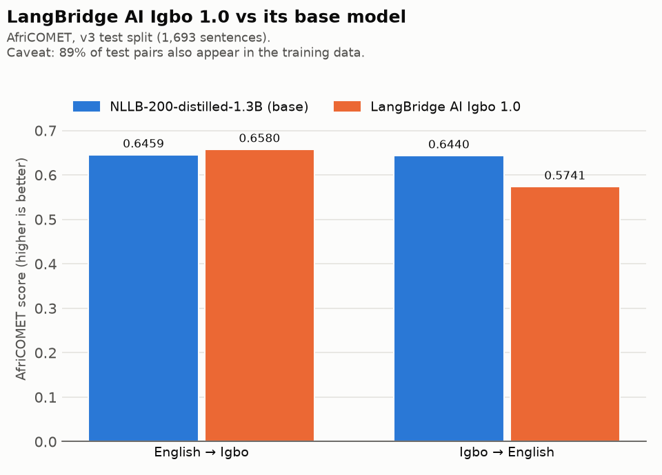
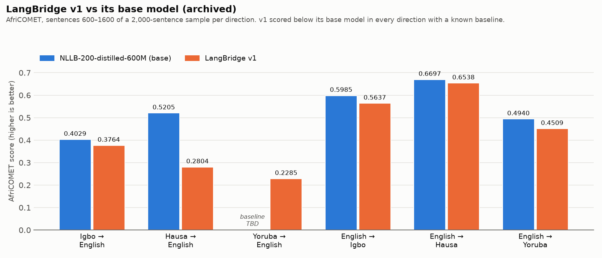

# Evaluation

This page explains how every score in this repository was produced, lists all of them, and records the problems found in the evaluation data.

Names used here:

- **LangBridge v1**: the archived multilingual model (NLLB-200-distilled-600M + LoRA, six directions).
- **LangBridge AI Igbo 1.0** (internal: v3): the current English → Igbo model (NLLB-200-distilled-1.3B + QLoRA).

All raw numbers are in [`results/`](../results). Tables on this page show 4 decimal places (rounded half-up). The CSV files keep every digit.

---

## 1. Metric: AfriCOMET

**COMET** is a learned evaluation metric for machine translation. A neural network reads the source sentence, the machine translation and a human reference translation, and predicts how good the translation is. Higher is better. The score is not a percentage, and it is most useful for comparing two systems on the same sentences.

**AfriCOMET** is a COMET model trained with extra data for African languages. Every COMET score in this project uses the AfriCOMET checkpoint **`masakhane/africomet-mtl`**. This is confirmed in [`notebooks/04_evaluation_africomet.ipynb`](../notebooks/04_evaluation_africomet.ipynb) and in the v1 copy at [`archive/v1/evaluation/afri-comet-evaluation-for-lang-bridge-ai.ipynb`](../archive/v1/evaluation/afri-comet-evaluation-for-lang-bridge-ai.ipynb). Both call `download_model("masakhane/africomet-mtl")`.

| Setting | Value | Source |
|---|---|---|
| Library | `unbabel-comet` 2.2.7 | notebook 04 output (`pip show unbabel-comet`) |
| Checkpoint | `masakhane/africomet-mtl` | notebook 04, cell 9 |
| Score reported | `system_score` (mean of sentence scores) | notebook 04, cell 11 |
| Batch size | 8, one GPU | notebook 04, cell 11 |
| Transformers pin | 4.41.0 (needed by COMET) | notebook 04, cell 4 |

**BLEU and chrF++ were not computed** for any reported result. (BLEU and chrF++ are string-overlap metrics: they count matching words or characters between the translation and the reference.) The v1 training notebook loads `sacrebleu` for validation during training, but no BLEU score was saved. No significance test has been run for any result.

---

## 2. LangBridge AI Igbo 1.0 vs NLLB-200-distilled-1.3B

### Results

Source: [`results/igbo1_vs_nllb1.3b.csv`](../results/igbo1_vs_nllb1.3b.csv). The numbers come from the project's own records and match the [Hugging Face model card](https://huggingface.co/coded-by-49/LANGBRIDGE_AI_IGBO_1.0). No saved notebook output in this repository contains them (see [Reproducing](#reproducing-the-igbo-10-numbers)).

| Direction | NLLB-1.3B baseline | LangBridge AI Igbo 1.0 | Absolute change | Relative change |
|---|---|---|---|---|
| English → Igbo | 0.6459 | 0.6580 | +0.0122 | +1.88% |
| Igbo → English | 0.6440 | 0.5741 | −0.0699 | −10.86% |

> **Important: the test split is not fully held out.** 1,506 of its 1,693 rows (88.95%) also appear, word for word, in the training split. See [Data issue 4](#issue-4-test-split-overlaps-the-training-split). The English → Igbo gain above therefore mostly measures performance on sentences the adapter was trained on. It is not yet evidence of better translation of new text.

### Setup

| Item | Value | Source |
|---|---|---|
| Test set | `test` split of [`coded-by-49/langbridge_ai_v3_igbo_datasets`](https://huggingface.co/datasets/coded-by-49/langbridge_ai_v3_igbo_datasets) (file `igbo_eng_lv1_test_.jsonl`) | notebook 03, cell 12 |
| Test set size | 1,693 sentence pairs | notebook 03 output: "Full tokenized dataset size: 1693" |
| Test set content | MAFAND-MT dev (1,500 rows) + Ezeani et al. validation set (193 rows after de-duplication) | `scripts/data_v3/text_dataset_processing.py`; note file in the local data folder |
| Checkpoint | adapter at epoch 1.333666 (`coded-by-49/LANGBRIDGE_AI_IGBO_1.0`, `main`) | project records; [training.md](training.md#the-released-checkpoint-epoch-1333666) |
| Base model at evaluation time | loaded in 4-bit NF4 with bitsandbytes on a Kaggle T4 | notebook 03, cell 10 |
| Beam size | 4 | notebook 03, cell 26 |
| Max length | `max_new_tokens=256`; source truncated to 256 tokens | notebook 03, cells 18–19 and 26 |
| `forced_bos_token_id` | `tokenizer.convert_tokens_to_ids("ibo_Latn")` for English → Igbo | notebook 03, cell 26 |
| Repetition control | `no_repeat_ngram_size=3` | notebook 03, cell 26 |
| Inference batch | 8 sentences, in chunks of 100 | notebook 03, cells 24 and 26 |
| Same sentences for both models | yes (same split, same settings) | HF model card |

### Reproducing the Igbo 1.0 numbers

1. Run [`notebooks/03_evaluation.ipynb`](../notebooks/03_evaluation.ipynb) on a Kaggle GPU. It writes a JSON file of `{src, mt, ref}` records.
2. Upload that file as a Kaggle dataset and score it with [`notebooks/04_evaluation_africomet.ipynb`](../notebooks/04_evaluation_africomet.ipynb).
3. Repeat for each model and direction.

Before re-running notebook 03, fix its saved state. As saved, it is not consistent:

- It wraps the same `base_model` object with two adapters (`LANGBRIDGE_AI_IGBO_1.0` and `LANG_BRIDGE_AI_2.0`), then calls `.eval()` on one and `.generate()` on the other.
- The sample record it prints has an Igbo `src`, an Igbo `mt` and an English `ref`, so the source and reference columns do not match the direction being generated.

These problems suggest the notebook was edited after the reported runs. It needs one clean run per model and direction before the numbers can be reproduced from it.

---

## 3. LangBridge v1 vs NLLB-200-distilled-600M (archived)

### Setup

| Item | Value | Source |
|---|---|---|
| Test pool | 2,000 sentence pairs per direction, sampled with `random.seed(42)` from `{lang}_test_val.jsonl` in the v1 dataset `coded-by-49/Langbridge_wazobia_data` (now deleted) | `archive/v1/evaluation/langbridge-ai-inference-datapipeline.ipynb`, cell 10 |
| Sentence ranges | **separate slices** of that pool: [0, 100), [100, 600), [600, 1600) → 100, 500 and 1,000 sentences | same notebook, cell 20 (`EVAL_START`, `EVAL_END`) |
| Headline range | Sentences 600–1600 (largest slice) | — |
| Beam size | 4 | same notebook, cell 22 |
| Max length | `max_new_tokens=256` | same notebook, cell 22 |
| `forced_bos_token_id` | `tokenizer.convert_tokens_to_ids(target_lang)` | same notebook, cell 22 |
| Source language tag | **not set** in the saved notebook (tokenizer default `eng_Latn` is used even for Hausa/Igbo/Yoruba input) | same notebook, cell 8 |
| Repetition control | `no_repeat_ngram_size=3` | same notebook, cell 22 |
| Precision | float16, `torch.compile` | same notebook, cell 8 |

Note on the model id: the saved v1 inference notebook loads **`coded-by-49/LANG_BRIDGE_AI_2.0`**, not the v1 adapter `coded-by-49/Lang_bridge_AI`. The cached `adapter_config.json` shows `LANG_BRIDGE_AI_2.0` is a LoRA adapter on NLLB-200-distilled-600M with r=8 and alpha=16, which is not the v1 configuration (r=32, alpha=64). Its output files are named `l1_…`. Which adapter produced the v1 table below is **not confirmed**. Both repositories are private.

### Full results

Source: [`results/v1_vs_nllb600m.csv`](../results/v1_vs_nllb600m.csv). Original sheet: [`archive/v1/langbridge_ai_inference_sheet.md`](../archive/v1/langbridge_ai_inference_sheet.md).

**LangBridge v1**

| Direction | Sentences 0–100 | Sentences 100–600 | Sentences 600–1600 |
|---|---|---|---|
| Igbo → English | 0.3091 | 0.3685 | 0.3764 |
| Hausa → English | 0.2772 | 0.2794 | 0.2804 |
| Yoruba → English | 0.1987 | 0.2389 | 0.2285 |
| English → Igbo | 0.5325 | 0.5678 | 0.5637 |
| English → Hausa | 0.6592 | 0.6600 | 0.6538 |
| English → Yoruba | 0.4223 | 0.4578 | 0.4509 |

**NLLB-200-distilled-600M (baseline)**

| Direction | Sentences 0–100 | Sentences 100–600 | Sentences 600–1600 |
|---|---|---|---|
| Igbo → English | 0.4021 | 0.4159 | 0.4029 |
| Hausa → English | 0.5210 | 0.5187 | 0.5205 |
| Yoruba → English | TBD | TBD | TBD |
| English → Igbo | 0.5616 | 0.5992 | 0.5985 |
| English → Hausa | 0.6778 | 0.6777 | 0.6697 |
| English → Yoruba | 0.4842 | 0.4991 | 0.4940 |

**Summary at Sentences 600–1600**

| Direction | NLLB-600M | LangBridge v1 | Absolute change | Relative change |
|---|---|---|---|---|
| Igbo → English | 0.4029 | 0.3764 | −0.0264 | −6.57% |
| Hausa → English | 0.5205 | 0.2804 | −0.2401 | −46.13% |
| Yoruba → English | TBD | 0.2285 | TBD | TBD |
| English → Igbo | 0.5985 | 0.5637 | −0.0347 | −5.80% |
| English → Hausa | 0.6697 | 0.6538 | −0.0159 | −2.38% |
| English → Yoruba | 0.4940 | 0.4509 | −0.0431 | −8.73% |

### v1 "overfitting evaluation"

Source: [`results/v1_overfitting_eval.csv`](../results/v1_overfitting_eval.csv). These scores are kept only here and in [experiments.md](experiments.md). They are not in the README.

| Direction | Sentences 0–1000 |
|---|---|
| Hausa → English | 0.2623 |
| Yoruba → English | 0.2365 |
| Igbo → English | 0.3625 |

The Yoruba → English score (0.23646779036711085) is the saved output of notebook 04, which reads the file `l1_yor_eng_comet_overfit_eval_data_0_1000.json`. **Purpose not confirmed:** no code or note says which sentences went into these files. If they were training sentences, this was a check for overfitting. That is a guess.

### Reproducing the v1 numbers

The v1 numbers can no longer be fully reproduced, because the v1 dataset was deleted. The evaluation code is kept in [`archive/v1/evaluation/`](../archive/v1/evaluation). The Igbo and Yoruba `*_test_val.jsonl` files still exist in a local Hugging Face cache on the author's machine. That could be enough to recompute the missing Yoruba → English baseline.

---

## 4. Do not compare v1 and Igbo 1.0 scores directly

The two models use different base models (600M vs 1.3B parameters) and different test sets (a sample of the deleted v1 data vs the v3 test split). For example, the **base model alone** scores 0.5985 on English → Igbo in the v1 tests and 0.6459 in the Igbo 1.0 tests. Part of that gap comes from the bigger base model, and part from the different sentences. Compare each model only with its own baseline.

---

## 5. Data issues found

### Issue 1: copied Yoruba → English baseline

**What:** In the original results sheet, the NLLB-600M Yoruba → English scores (0.4021051446907222, 0.4159341849889606, 0.40285637013643283) are exact copies of the NLLB-600M Igbo → English scores.

**Check:** The saved output of the v1 AfriCOMET notebook shows 0.4021051446907222 was computed from `nllb_igbo_eng_comet_eval_data_0_100.json`, an Igbo → English file. No notebook output, note or git commit contains a separate Yoruba → English baseline.

**Resolution:** The value is marked **TBD** in every CSV, table and chart. The copied numbers are not shown as real anywhere. The Yoruba → English row of the summary table is TBD.

### Issue 2: meaning of the sentence ranges

**What:** It was unclear whether "0–100, 100–600, 600–1600" were separate slices or growing samples.

**Check:** In the v1 inference notebook, `EVAL_START` and `EVAL_END` index into a fixed 2,000-sentence pool. Output files are named `…_{EVAL_START}_{EVAL_END}.json`.

**Resolution:** They are **separate, non-overlapping slices** of 100, 500 and 1,000 sentences. Columns are labelled "Sentences 0–100" and so on. The 600–1600 slice (largest) is the headline number.

### Issue 3: purpose of the "overfitting evaluation"

**What:** Three v1 scores labelled "overfitting evaluation" have no stated purpose.

**Check:** The only code is notebook 04, which scores a pre-built file. The notebook that built the file and the dataset behind it (`henryaloh/l1-yor-eng-comet-overfit-eval-data`, a private Kaggle dataset) are not in the repository.

**Resolution:** Purpose not confirmed. The scores are kept in this page and [experiments.md](experiments.md) with that note, and left out of the README.

### Issue 4: test split overlaps the training split

**What:** This was found during the repository overhaul. It was not in the original project notes.

**Check:** [`scripts/check_split_overlap.py`](../scripts/check_split_overlap.py) downloads the Hugging Face splits and compares exact (English, Igbo) pairs. Output: [`results/v3_split_overlap.csv`](../results/v3_split_overlap.csv).

| Split | Rows | Rows whose exact pair is in train | Share |
|---|---|---|---|
| validation (full) | 597 | 0 | 0.00% |
| validation (256-token filtered, used during training) | 589 | 0 | 0.00% |
| test | 1,693 | 1,506 | 88.95% |

All 1,500 test rows that come from MAFAND-MT dev are also in the training split. Only 187 test rows (mostly from the Ezeani et al. set) are not.

**Resolution:** The reported scores are kept unchanged, because they are the recorded results. Every page that shows them carries this warning. The next steps are in the [roadmap](roadmap.md):

1. Re-score both models on the 187 clean test rows and on the validation split.
2. Rebuild the splits so the test set shares no pairs with training.
3. Retrain if needed.

### Issue 5: validation and test sizes swapped on the Hugging Face cards

**What:** The dataset card and the model card list Validation = 1,693 and Test = 597. The files say the opposite: the test file has 1,693 rows and the validation file has 597 (589 after filtering). The dataset's commit history shows the two files were renamed on 2026-09-30.

**Resolution:** This repository uses the file sizes. The card text needs a fix (listed in the PR).
