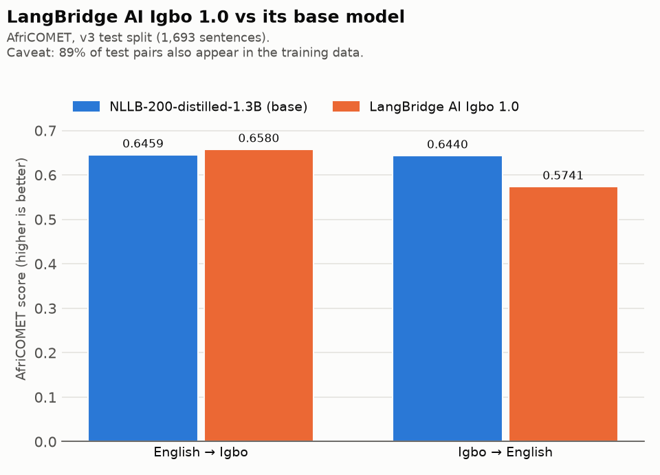

# LangBridge AI: From a Failed Multilingual Fine-Tune to a Focused English → Igbo Adapter

**Fabian Bernard**, November 2026

Technical report for **LangBridge v1** (archived) and **LangBridge AI Igbo 1.0** (internal: v3). Code: this repository. Model: [coded-by-49/LANGBRIDGE_AI_IGBO_1.0](https://huggingface.co/coded-by-49/LANGBRIDGE_AI_IGBO_1.0). Data: [coded-by-49/langbridge_ai_v3_igbo_datasets](https://huggingface.co/datasets/coded-by-49/langbridge_ai_v3_igbo_datasets).

---

## Abstract

LangBridge AI fine-tunes Meta's NLLB-200 for Nigerian languages. The first attempt, LangBridge v1, trained one LoRA adapter on NLLB-200-distilled-600M for six Hausa, Igbo and Yoruba ↔ English directions, using about 3–4 million pairs of mixed-quality data. It scored below its own base model on AfriCOMET in every direction with a known baseline, by 2.38% to 46.13%. We then narrowed the scope to one direction and a small, human-translated corpus. LangBridge AI Igbo 1.0 is a 4-bit QLoRA (rsLoRA, r=32) adapter on NLLB-200-distilled-1.3B, trained on 12,009 English → Igbo pairs. On the project's test split it scores 0.6580 AfriCOMET against the base model's 0.6459 (+1.88% relative), and it drops 10.86% on the untrained reverse direction. An audit found that 88.95% of the test pairs also appear in the training data. The gain is therefore not yet a held-out result, and no significance test has been run.

---

## 1. Introduction

Hausa, Igbo and Yoruba each have tens of millions of speakers, yet they have little parallel text compared with European languages. Machine translation (MT) for them is weaker, and errors are harder to spot for developers who do not speak them. Better MT helps with access to information, education and public services. It also helps people build software in their own languages.

Large multilingual models such as NLLB-200 already cover these languages. The practical question for a single developer with free cloud GPUs is whether a small, cheap fine-tune can make one of these models measurably better for a Nigerian language. Honest evaluation is part of that question.

This report covers two attempts:

- **LangBridge v1**, a broad multilingual fine-tune that failed (Section 4).
- **LangBridge AI Igbo 1.0**, a focused English → Igbo fine-tune (Sections 5–8).

It also covers the evaluation problems we found along the way. Section 9 lists the limitations, including the train/test overlap.

## 2. Background

**NLLB-200.** "No Language Left Behind" is a family of Transformer encoder–decoder translation models from Meta that cover 200 languages (NLLB Team, 2022). Each language has a code, such as `eng_Latn` or `ibo_Latn`. At inference the source code is added to the input. The target code is forced as the first generated token, which tells the decoder which language to write (the `forced_bos_token_id` setting). We use the distilled 600M- and 1.3B-parameter versions. Their weights are licensed CC-BY-NC-4.0 (non-commercial).

**LoRA and QLoRA.** Full fine-tuning updates every weight, which is too expensive on free GPUs. **LoRA** (Hu et al., 2021) freezes the model. It adds two small matrices A and B to selected linear layers, and the layer's output becomes W·x + (α/r)·B·A·x. Only A and B are trained, and r (the rank) controls their size. **QLoRA** (Dettmers et al., 2023) also stores the frozen weights in 4-bit **NF4** format, a 4-bit number format designed for normally distributed weights. This cuts memory further. **rsLoRA** (Kalajdzievski, 2023) changes the scale from α/r to α/√r, which keeps updates stable at higher ranks.

**COMET and AfriCOMET.** String-overlap metrics such as BLEU reward exact word matches, which is harsh for morphologically rich languages with variable spelling. **COMET** (Rei et al., 2020) is a neural network trained to predict human quality judgements from the source, the translation and a reference. **AfriCOMET** (Wang et al., 2024) adapts COMET to African languages. All scores here use the `masakhane/africomet-mtl` checkpoint. Scores are not percentages. They are meaningful as differences between systems on the same sentences.

## 3. Setup common to both versions

- **Hardware:** free Kaggle notebooks with NVIDIA Tesla T4 GPUs (15 GB each).
- **Libraries:** Hugging Face Transformers, PEFT, bitsandbytes, Accelerate, Datasets. AfriCOMET via `unbabel-comet` 2.2.7.
- **Evaluation decoding:** beam search with 4 beams, up to 256 new tokens, `no_repeat_ngram_size=3`, and `forced_bos_token_id` set to the target language.

## 4. First attempt: LangBridge v1

### 4.1 Setup

From the saved v1 notebooks ([`archive/v1/`](../archive/v1)):

- **Base model:** NLLB-200-distilled-600M, loaded in 4-bit NF4 (double quantization, bfloat16 compute).
- **Adapter:** LoRA r=32, α=64, dropout 0.05 on `q/k/v/out_proj`. The old README also lists `fc1` and `fc2`.
- **Training:** batch 16 × 2 accumulation, learning rate 2e-4, 1 epoch, one T4.
- **Data:** "LangBridge Wazobia", built from JW300, OPUS (CCMatrix, WikiTitles, XLEnt), FLORES-200, Tatoeba, Hypa_Fleurs, MAFAND-MT and web scraping. The data pipeline merged 3,000,000 tokenized examples (the README says over 4 million). The saved pipeline code builds only into-English pairs, truncated to 128 tokens. Cleaning used Unicode-block, control-character and repetition filters plus exact de-duplication ([data.md](data.md#1-langbridge-v1-data-deleted)). This dataset has since been deleted.

### 4.2 Results

Evaluation used 2,000 random pairs per direction from the v1 test/validation files. They were scored in three separate slices (sentences 0–100, 100–600, 600–1600). Table 1 shows the largest slice. Full tables are in [evaluation.md](evaluation.md).

**Table 1.** AfriCOMET, Sentences 600–1600 (1,000 sentences per direction). Source: [`results/v1_vs_nllb600m.csv`](../results/v1_vs_nllb600m.csv).

| Direction | NLLB-600M | LangBridge v1 | Absolute change | Relative change |
|---|---|---|---|---|
| Igbo → English | 0.4029 | 0.3764 | −0.0264 | −6.57% |
| Hausa → English | 0.5205 | 0.2804 | −0.2401 | −46.13% |
| Yoruba → English | TBD | 0.2285 | TBD | TBD |
| English → Igbo | 0.5985 | 0.5637 | −0.0347 | −5.80% |
| English → Hausa | 0.6697 | 0.6538 | −0.0159 | −2.38% |
| English → Yoruba | 0.4940 | 0.4509 | −0.0431 | −8.73% |

The Yoruba → English baseline in the original sheet was an exact copy of the Igbo → English row. The real value was not found, so it is reported as TBD.

### 4.3 Why v1 failed

v1 was worse than doing nothing, in every direction we can check. The pattern is clear: the into-English directions lost the most. The causes below are ordered by how well the code supports them.

1. **Missing source-language tag at evaluation (supported by code; impact not measured).** The saved v1 inference notebook never sets `tokenizer.src_lang`, so Hausa, Igbo and Yoruba input is tagged as English (`eng_Latn`). This can only harm the into-English directions, which matches where v1 lost most. We do not know whether the baseline was scored with the same notebook, so the size of this effect is unknown.
2. **Noisy, off-domain training data (supported by sources).** Much of the data came from religious text (JW300) and web-mined corpora (CCMatrix). The filters were character-level only. Our guess is that one of them (a single character making up ≥ 20% of a line, spaces included) also removed clean sentences, while semantic misalignments passed through.
3. **Six directions in one small adapter (design choice).** One attention-only LoRA had to serve six directions, with no per-direction monitoring. Validation during training used Igbo only.
4. **Possibly very short training (code, unconfirmed).** The training notebook's evaluation callback contains a typo (`model.devic`) that would crash at step 500. The `try/except` would then save a "salvage" adapter after about 16,000 of 3 million examples. No outputs were saved, so we cannot tell whether the published adapter came from such a run.
5. **Model identity is uncertain.** The saved v1 inference notebook loads `coded-by-49/LANG_BRIDGE_AI_2.0` (a 600M adapter with r=8), not the v1 adapter. Which adapter produced Table 1 is not confirmed.

## 5. The pivot

v1 taught us to change one thing at a time and to measure each change. We made two changes:

1. **Cleaner data.** We replaced millions of mixed pairs with three human-translated, research-grade sources: FLORES-101/200, the Igbo–English benchmark of Ezeani et al. (2020), and MAFAND-MT (Adelani et al., 2022). MAFAND-MT's own finding, that a few thousand high-quality pairs go a long way, guided this choice.
2. **One language, one direction.** English → Igbo only, so that success or failure can be measured cleanly before scaling up.

**Cleaning and building steps** ([`scripts/data_v3/`](../scripts/data_v3)):

1. Align English and Igbo text files line by line into JSONL pairs.
2. Remove rows whose English side already appears in another source file.
3. Concatenate files and renumber ids.
4. Drop validation pairs longer than 256 NLLB tokens on either side (597 → 589).

The result has 12,009 training pairs, 597 validation pairs (589 after filtering) and 1,693 test pairs. All of it is news or encyclopedic text.

## 6. Method: LangBridge AI Igbo 1.0

### 6.1 Model and adapter

- **Base model:** NLLB-200-distilled-1.3B, loaded in 4-bit NF4 with double quantization and float32 compute, then prepared for k-bit training.
- **Adapter:** rsLoRA with r=32, α=32 (scale 32/√32 ≈ 5.66), dropout 0.05, bias `lora_only`. It is applied to all linear layers (`q/k/v/out_proj`, `fc1`, `fc2`). The adapter file is 188.9 MB.
- **Inputs:** English inputs and Igbo labels, each truncated to 256 tokens.
- **Training setup:** two T4 GPUs with `accelerate` (data parallel). Batch 3 per GPU × 4 accumulation steps = an effective batch of 24. fp16, gradient checkpointing, label smoothing 0.1, gradient clipping at 1.0.

### 6.2 Choosing the learning rate

We ran an LR range test (Smith, 2017) with the same model, adapter and effective batch (24). It ran for 501 iterations, with the learning rate growing exponentially from 1e-7 to 5, and took 9 h 45 min on one T4.

- The loss started to fall near 1e-5.
- It reached its minimum of 1.9904 at 5.14e-4.
- It was 1.9937 at about 3.36e-4.
- It became NaN from about 0.24.

The tool's automatic suggestion (0.2287, the steepest point) fell in the diverged region and was ignored. We set the peak learning rate to **3.3e-4**, a little below the loss minimum, and the floor to **2e-5**, just above where learning starts ([plot](../results/lr_range_test/lr_zoom_1e-7_to_3e-3.png)).

### 6.3 Cyclical learning rate

We used PyTorch `CyclicLR` in triangular mode. The learning rate rises linearly from 2e-5 to 3.3e-4 over `step_size_up=1002` optimizer steps, then falls back over the same number of steps. One epoch is about 501 steps (12,009 examples ÷ 24, rounded up per GPU), so the rise takes about 2 epochs. That is the low end of the 2–10 epoch half-cycle Smith recommends. Momentum cycling is off (`cycle_momentum=False`). A cyclical schedule avoids hand-tuning a decay schedule, and it lets the run explore higher learning rates without staying at them.

### 6.4 Early stopping and the released checkpoint

Evaluation and checkpointing ran every 167 steps (about three times per epoch). The best checkpoint was chosen by validation loss (`load_best_model_at_end=True`). Early stopping was configured with a patience of 12 evaluations, although the model card says 7 and the project notes said 2. The run was planned for up to 9.4 epochs (4,710 steps).

The released adapter is from **epoch 1.333666**. This number fits the setup exactly. Each GPU processes 2,002 micro-batches per epoch, and 1 + 668/2,002 = 1.333666. That is **global step 668, the fourth evaluation point**. With best-checkpoint selection, the likely explanation is that step 668 had the lowest validation loss and later evaluations did not improve on it. A small dataset on a strong base model is expected to overfit within a few epochs. The training logs (`trainer_state.json`) were not kept, so we cannot confirm whether training ended by early stopping or by a session limit. At step 668 the cyclical learning rate was still rising, about two thirds of the way to its peak.

## 7. Results

**Table 2.** AfriCOMET on the v3 test split (1,693 pairs), checkpoint epoch 1.333666. Both systems were run with the same decoding settings and with the base model in 4-bit. Source: [`results/igbo1_vs_nllb1.3b.csv`](../results/igbo1_vs_nllb1.3b.csv).

| Direction | NLLB-1.3B baseline | LangBridge AI Igbo 1.0 | Absolute change | Relative change |
|---|---|---|---|---|
| English → Igbo | 0.6459 | 0.6580 | +0.0122 | +1.88% |
| Igbo → English | 0.6440 | 0.5741 | −0.0699 | −10.86% |

BLEU and chrF++ were not computed. No significance test was run.

**Table 3.** Overlap between the v3 test and training splits (exact English–Igbo pairs). Source: [`results/v3_split_overlap.csv`](../results/v3_split_overlap.csv).

| Split | Rows | Rows also in train |
|---|---|---|
| Validation (used for checkpoint selection) | 589 | 0 (0.00%) |
| Test | 1,693 | 1,506 (88.95%) |

## 8. Analysis

**Why English → Igbo improved.** The adapter was trained only on English → Igbo. Its training data is news and encyclopedic text, the same style as the test set. A gain in the trained direction is the expected outcome. However, 1,506 of the 1,693 test pairs were also training pairs (Table 3), because MAFAND-MT dev ended up in both splits. On those sentences the model is partly being tested on memorized material. So Table 2 does **not** show that Igbo 1.0 translates new English text better than the base model. It shows that the adapter moved the model towards the training data. A clean measurement uses the 187 non-overlapping test rows and the untouched validation split, or a rebuilt test set.

**Why Igbo → English regressed.** Every training example had English as the source and Igbo as the target. The adapter changes weights shared by both directions: all linear layers of the encoder and decoder. Nothing in training rewarded keeping the reverse direction intact. Fine-tuning on one direction can shift the decoder towards Igbo-style output and the encoder towards English input, which hurts the opposite task. This is a known risk of one-directional fine-tuning. It is why production routes Igbo → English, and every direction other than English → Igbo, to the base model.

**How big the gain is.** +0.0122 AfriCOMET (+1.88% relative) is small. There is no significance test, no second metric and no human evaluation. Given the overlap above, the honest summary is: a small improvement in the trained direction on a mostly-seen test set, and a clear regression in the untrained direction.

**Why v1 and Igbo 1.0 numbers cannot be compared.** They use different base models (600M vs 1.3B) and different test sets (a sample of the deleted v1 data vs the v3 test split). For example, the base model alone scores 0.5985 on English → Igbo in the v1 test and 0.6459 in the v3 test. Each model must be compared only with its own baseline. On that basis the story is: v1 lost to its baseline everywhere, then the project pivoted to clean data and one language, and Igbo 1.0 edges its baseline in its target direction. That last result is unconfirmed until the evaluation is rebuilt on clean data.

## 9. Limitations

- **Test contamination.** 88.95% of test pairs appear in training, so the English → Igbo gain is not a held-out result.
- **Small effect, no statistics.** +1.88% relative, with no significance test and one automatic metric.
- **One direction.** The adapter is worse than its base model for Igbo → English, and it was not trained or evaluated for any other pair.
- **Domain.** News and encyclopedic text only. Informal, conversational and dialectal Igbo is not covered.
- **Reproducibility gaps.** Training logs, the exact library versions of the successful run, and the generated evaluation files were not saved. The saved evaluation notebook is in an inconsistent state.
- **Precision.** Both models were evaluated with the base model in 4-bit. CPU deployment will use float32 or int8, and scores there have not been measured.
- **v1 records are incomplete.** The v1 dataset is deleted. One baseline value is missing, and which adapter produced the v1 scores is not confirmed.
- **License.** The weights derive from NLLB-200 (CC-BY-NC-4.0), and one data source (MAFAND-MT) is CC-BY-NC-4.0. Commercial use is not permitted.

## 10. Future work

1. **Clean evaluation and significance testing.** Rebuild the splits with zero overlap, re-score both models, and report paired bootstrap resampling confidence intervals (Koehn, 2004). Add chrF++ and BLEU.
2. **Human evaluation.** Native Igbo speakers rate a blind sample of outputs from both models.
3. **The other five directions.** Apply the same recipe one direction at a time (Igbo → English, then Hausa and Yoruba), each with its own clean test set.
4. **Per-direction routing.** Serve each direction with the best model for it, base or adapter. Promote a new model only if it beats the current one on the same clean test set.
5. **Deployment.** Merge the adapter, convert to CTranslate2 int8, and serve on free CPU hosting ([deployment.md](deployment.md)).

## 11. References

- Adelani, D. et al. (2022). A Few Thousand Translations Go a Long Way! Leveraging Pre-trained Models for African News Translation. *NAACL*. https://aclanthology.org/2022.naacl-main.223
- Dettmers, T. et al. (2023). QLoRA: Efficient Finetuning of Quantized LLMs. arXiv:2305.14314.
- Ezeani, I. et al. (2020). Igbo-English Machine Translation: An Evaluation Benchmark. arXiv:2004.00648.
- Goyal, N. et al. (2022). The Flores-101 Evaluation Benchmark for Low-Resource and Multilingual Machine Translation. *TACL* 10:522–538.
- Hu, E. et al. (2021). LoRA: Low-Rank Adaptation of Large Language Models. arXiv:2106.09685.
- Kalajdzievski, D. (2023). A Rank Stabilization Scaling Factor for Fine-Tuning with LoRA. arXiv:2312.03732.
- Koehn, P. (2004). Statistical Significance Tests for Machine Translation Evaluation. *EMNLP*.
- NLLB Team et al. (2022). No Language Left Behind: Scaling Human-Centered Machine Translation. arXiv:2207.04672.
- Rei, R. et al. (2020). COMET: A Neural Framework for MT Evaluation. *EMNLP*. arXiv:2009.09025.
- Smith, L. N. (2017). Cyclical Learning Rates for Training Neural Networks. *WACV*. arXiv:1506.01186.
- Wang, J. et al. (2024). AfriMTE and AfriCOMET: Enhancing COMET to Embrace Under-resourced African Languages. *NAACL*.

More links: [references.md](references.md).
