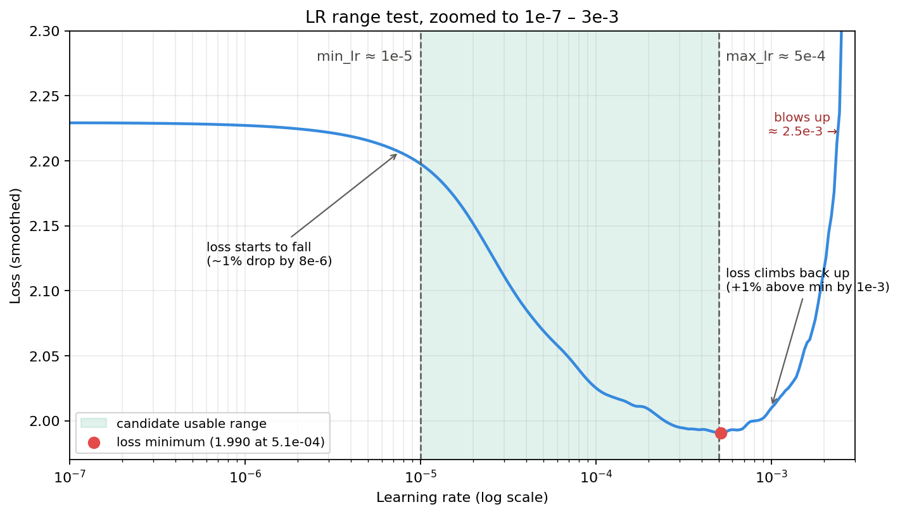

# Training: LangBridge AI Igbo 1.0

This page describes how **LangBridge AI Igbo 1.0** (internal: v3) was trained, why each setting was chosen, and how to run training again.

- Training script: [`src/langbridge/train.py`](../src/langbridge/train.py)
- Kaggle launcher: [`notebooks/02_training_runner_kaggle.ipynb`](../notebooks/02_training_runner_kaggle.ipynb)
- Learning-rate range test: [`notebooks/01_lr_range_test_cyclic_lr.ipynb`](../notebooks/01_lr_range_test_cyclic_lr.ipynb), results in [`results/lr_range_test/`](../results/lr_range_test)
- Settings in one place: [`configs/igbo_1.0_qlora.yaml`](../configs/igbo_1.0_qlora.yaml) (a reference copy; the script does not read it)

Each "why" below is marked as one of:

- **(code)**: stated in a code comment or notebook.
- **(derived)**: computed from the code.
- **(guess)**: a likely reason that nothing in the repository confirms.

---

## Key terms

- **NLLB-200**: Meta's "No Language Left Behind" translation model. It covers 200 languages. Each language has a code such as `eng_Latn` (English, Latin script) or `ibo_Latn` (Igbo).
- **LoRA (Low-Rank Adaptation)**: a way to fine-tune a big model by training only small extra matrices added to some layers. The original weights stay frozen.
- **QLoRA**: LoRA on top of a base model that is loaded in 4-bit precision to save GPU memory.
- **NF4**: "4-bit NormalFloat", the 4-bit number format QLoRA uses for the frozen weights.
- **rsLoRA (rank-stabilized LoRA)**: scales the LoRA update by alpha/√r instead of alpha/r. This keeps training stable at higher ranks.
- **Gradient accumulation**: add up gradients over several small batches before each weight update. This acts like a bigger batch.
- **Epoch**: one full pass over the training data.

---

## Hardware and launch

| Item | Value | Source |
|---|---|---|
| GPUs | 2 × NVIDIA Tesla T4 (15 GB each), Kaggle | `nvidia-smi` output in notebooks 02 and 03 |
| Launcher | `accelerate launch --num_processes 2 --debug <script>` | notebook 02, cell 3 |
| Parallelism | PyTorch DDP (one model copy per GPU) | `ddp_find_unused_parameters=False` in train.py |
| Library versions in the saved runner | accelerate 1.15.0, transformers 5.16.1 | notebook 02, cells 1–2 |
| Logging | stdout/stderr to `/kaggle/working/ddp_debug.log`; metrics to `training_metrics.jsonl` and `evaluation_metrics.jsonl` (custom callback) | notebook 02 and train.py |
| Environment flags | `TORCH_DISTRIBUTED_DEBUG=DETAIL`, `CUDA_LAUNCH_BLOCKING=1`, `PYTORCH_CUDA_ALLOC_CONF=expandable_segments:True` | notebook 02, cell 3 |

The runner starts training as a background `subprocess.Popen` and polls it. The notebook stays responsive, and logs survive on disk if the kernel dies **(guess)**.

---

## Model and quantization

| Setting | Value | Why |
|---|---|---|
| Base model | `facebook/nllb-200-distilled-1.3B` | Bigger than the 600M model used in v1. The 1.3B base already scores higher on English → Igbo (0.6459 vs 0.5985 in the two projects' tests; not a like-for-like comparison) **(guess)** |
| `tie_word_embeddings` | `False` (set on the config before loading) | Not documented **(guess: to keep the output layer separate from the input embeddings under PEFT)** |
| 4-bit loading | `load_in_4bit=True`, `nf4`, double quantization | Lets a 1.3B model and its activations fit on a 15 GB T4 **(guess)** |
| 4-bit compute dtype | `float32` | Not documented **(guess: numerical stability)** |
| Model dtype | `torch_dtype=float32` | Same as above **(guess)** |
| k-bit preparation | `prepare_model_for_kbit_training` | Standard QLoRA step: casts norms and enables input gradients for checkpointing |

## LoRA adapter

| Setting | Value | Why |
|---|---|---|
| Target modules | `all-linear` → `q_proj, k_proj, v_proj, out_proj, fc1, fc2` (from the published `adapter_config.json`) | Adapting attention and feed-forward layers gives the adapter more capacity than attention only, which is all the v1 notebook used **(guess)** |
| Rank `r` | 32 | **(guess)** same rank as v1 |
| `lora_alpha` | 32 | With rsLoRA the scale is 32/√32 ≈ 5.66 **(derived)** |
| `use_rslora` | `True` | Stable updates at rank 32 (property of rsLoRA) |
| `lora_dropout` | 0.05 | Light regularisation **(guess)** |
| `bias` | `lora_only` | Also trains the bias terms of adapted layers **(guess: small extra capacity)** |
| Adapter size | 188,852,112 bytes (`adapter_model.safetensors`) | Hugging Face file listing |

## Data and tokenization

| Setting | Value | Source |
|---|---|---|
| Training data | `train` split of `coded-by-49/langbridge_ai_v3_igbo_datasets`, 12,009 pairs | train.py; line count of the split file |
| Validation data | `igbo_eng_lv1_validation_256_filtered.jsonl`, 589 pairs | train.py; line count |
| Direction | **English → Igbo only**: `eng_Latn` inputs, `ibo_Latn` labels | `tokenize_function` in train.py |
| Tokenizer | `NllbTokenizer(src_lang="eng_Latn", tgt_lang="ibo_Latn", truncation_side="right", model_max_length=256)` | train.py |
| Max length | 256 tokens for source and target, truncated | train.py |
| Padding | dynamic, multiple of 8, via `DataCollatorForSeq2Seq` (labels padded with −100 so padding is ignored by the loss) | train.py; padding checks printed before training |

The script prints a padding audit before training (`inspect_stored_labels`, `inspect_actual_batch`). It checks that padding tokens in the labels are replaced by −100, so they do not count towards the loss **(code)**.

## Optimisation

| Setting | Value | Why |
|---|---|---|
| Per-GPU batch size | 3 | Memory limit on a T4 **(guess)** |
| Gradient accumulation | 4 | Effective batch = 3 × 4 × 2 GPUs = **24** **(derived)**. The LR range test also used an effective batch of 24 (6 × 4 accumulation, `desired_batch_size=24`) **(code)**, so the learning rates it found apply here |
| Optimizer | `torch.optim.AdamW`, lr 2e-5, weight decay 0.01 | Standard for transformer fine-tuning. The optimizer lr is overwritten by the scheduler **(derived)** |
| Scheduler | `CyclicLR`, `triangular`, `base_lr=2e-5`, `max_lr=3.3e-4`, `step_size_up=1002`, `cycle_momentum=False` | See [LR range test](#how-the-learning-rate-was-chosen) |
| `cycle_momentum` | `False` | Code comment: "i will go for simple right now" **(code)**. AdamW has no classic momentum term for CyclicLR to cycle |
| Epochs | `num_train_epochs=9.4` | An upper bound; early stopping can end training sooner. 9.4 epochs = 4,710 optimizer steps (the runner printed `0/4710`) **(derived)** |
| Mixed precision | `fp16=True`, `bf16=False` | The T4 has no fast bfloat16 support **(guess)** |
| Gradient checkpointing | on, `use_reentrant=False` | Saves memory by recomputing activations **(guess)** |
| Gradient clipping | `max_grad_norm=1.0` | Default-style safety against loss spikes **(guess)** |
| Label smoothing | 0.1 | Regularisation. The data collator is given the model "for label smoothing use case" **(code)** |
| Logging | every 3 steps | Fine-grained loss curves **(guess)** |

### Steps per epoch (derived)

- Each GPU gets ⌈12,009 / 2⌉ = 6,005 examples → ⌈6,005 / 3⌉ = **2,002 micro-batches per epoch**.
- With 4-step accumulation that is **≈501 optimizer steps per epoch** (500 full steps plus one partial step).
- 9.4 epochs × 501 ≈ **4,710 steps**. This matches the runner's progress bar.

### How the learning rate was chosen

An **LR range test** trains for a short time while the learning rate grows exponentially. You then look at how the loss changes. The useful range runs from where loss starts to fall to just before it stops improving. This is the method from Smith (2017), "Cyclical Learning Rates for Training Neural Networks".

Settings ([notebook 01](../notebooks/01_lr_range_test_cyclic_lr.ipynb); results in [`results/lr_range_test/result.json`](../results/lr_range_test/result.json)):

- Same model, QLoRA and data as training. One GPU, batch 6 × 4 accumulation = 24.
- 501 iterations, learning rate from 1e-7 to 5, exponential steps, using `torch-lr-finder`.
- It took 9 h 45 min 10 s (`elapsed` in result.json).

Findings (from `result.json`):

| Point | Learning rate | Loss |
|---|---|---|
| Start | 1e-7 | 2.2292 |
| Loss starts to fall | ≈1e-5 | ≈2.1975 |
| Chosen `max_lr` | 3.3e-4 (nearest logged point: 3.36e-4) | 1.9937 |
| Lowest loss | 5.14e-4 | 1.9904 |
| Loss becomes NaN | from ≈0.237 | NaN |
| Tool's "suggested LR" | 0.2287 | in the NaN region, **not used** |



Why these values:

- **`max_lr = 3.3e-4`** sits inside the usable range and a little below the lowest-loss point (5.14e-4). The usual rule is to set the peak a bit below the point where loss stops improving **(guess)**.
- **`base_lr = 2e-5`** sits just above the point where loss starts to fall (≈1e-5) **(guess)**.
- `torch-lr-finder`'s automatic suggestion (steepest slope) landed at 0.2287, where the loss was already NaN. It was ignored. Lesson: always read the plot yourself.

### CyclicLR settings

- **Triangular mode:** the learning rate rises linearly from `base_lr` to `max_lr` over `step_size_up` steps, then falls back over the same number of steps, and repeats.
- **`step_size_up = 1002`** ≈ 2 epochs (2 × 501 steps) **(derived)**. One full cycle is ≈4 epochs. Smith (2017) recommends a half-cycle of 2–10 epochs' worth of iterations. 2 epochs is the low end **(guess about intent)**.
- At the released checkpoint (step 668) the learning rate was still **rising**, about two thirds of the way from `base_lr` to `max_lr` **(derived: 668 / 1002)**.

---

## Evaluation during training and checkpoint selection

| Setting | Value |
|---|---|
| `eval_strategy` / `save_strategy` | `steps` |
| `eval_steps` / `save_steps` | 167 (≈ 3 evaluations per epoch: 501 / 3 = 167) **(derived)** |
| `save_total_limit` | `None` (every checkpoint is kept) |
| `load_best_model_at_end` | `True` |
| `metric_for_best_model` | `eval_loss` (lower is better) |
| Early stopping | `EarlyStoppingCallback(early_stopping_patience=12)` |

**Early stopping** ends training when the validation loss has not improved for a set number of evaluations (the "patience").

> **Patience mismatch:** the code says 12. The Hugging Face model card says 7. The original project brief said 2. This page follows the code.

### The released checkpoint: epoch 1.333666

**What is confirmed:**

- Epoch 1.333666 is **global step 668**, the 4th evaluation/save point (4 × 167) **(derived)**. In the first epoch each GPU runs 2,002 micro-batches (501 optimizer steps). 167 more steps then make 668 micro-batches into epoch 2. 1 + 668 / 2,002 = **1.333666**. The match also confirms the run used 2 GPUs, batch 3, accumulation 4 and the 12,009-row training split.
- The bundling notebook labels this adapter "epoch 1.33 adapter first main run" ([notebook 05](../notebooks/05_bundling_for_production.ipynb)).
- With `load_best_model_at_end=True` and `metric_for_best_model="eval_loss"`, the model the trainer saves at the end is the checkpoint with the **lowest validation loss**.

**Most likely explanation:** step 668 had the lowest validation loss of the run, and the validation loss did not improve after it. With patience 12, early stopping would then end training at step 668 + 12 × 167 = 2,672 (≈ epoch 5.3) at the earliest, and the best checkpoint (step 668) would be loaded at the end.

**Not confirmed:** `trainer_state.json`, the metric logs and the Kaggle output of this run are not in the repository or on Hugging Face. So it cannot be shown whether training stopped through early stopping, a Kaggle session limit or a manual stop. Adding `trainer_state.json` (it records `best_model_checkpoint` and every `eval_loss`) would settle this.

Why stopping early makes sense here: the training set is small (12,009 pairs), the base model already translates English → Igbo well, and the adapter has ~47M parameters. Fitting the training set further would likely stop helping validation loss within a few epochs **(guess; the adapter size is estimated from the 188.9 MB float32 file)**.

---

## How to rerun training on Kaggle

1. **Create a Kaggle notebook** with a "GPU T4 × 2" accelerator and internet on.
2. **Add a secret** named `HF_TOKEN` (Add-ons → Secrets) with a Hugging Face token that can read the dataset (and write, if you will push the adapter).
3. **Make the script available.** The runner expects the script at:
   ```
   /kaggle/usr/lib/notebooks/bernardchiagoziem/lb_train_script_main/notebooks/bernardchiagoziem/lb_train_script_main.py
   ```
   That path exists when the Kaggle script notebook `bernardchiagoziem/lb_train_script_main` is attached as a utility script. To use the repository copy instead, upload `src/langbridge/train.py` and change the path in cell 3 of [notebook 02](../notebooks/02_training_runner_kaggle.ipynb).
4. **Run notebook 02.** Cell 0 installs `bitsandbytes>=0.46.1` and the latest `accelerate`. Cell 3 starts `accelerate launch --num_processes 2`.
5. **Monitor** with cells 4–7: process status, the debug log, and the JSONL metric files in `/kaggle/working/`.
6. **Collect outputs:** checkpoints go to `/kaggle/working/langbridge_ai_checkpoints/checkpoint-<step>/`. The final model goes to `./testing_seq2seq_model`. Save `trainer_state.json` from the last checkpoint. It is the record that proves which checkpoint was best.

### Known problem with the saved runner

The last saved run of notebook 02 (2026-11-05) **failed at step 0** with:

```
ValueError: You cannot specify both decoder_input_ids and decoder_inputs_embeds at the same time
```

It ran with transformers 5.16.1. The Igbo 1.0 adapter was uploaded on 2026-11-03, so this failed run is a later attempt, not the run that produced the model. The cause is not recorded. One option to test is pinning the transformers version used for the successful run (that version is not recorded either). See [lessons_learned.md](lessons_learned.md#6-failed-ddp-run-decoder_input_ids-and-decoder_inputs_embeds).

### Time and cost

- The LR range test took 9 h 45 min on one T4 (`result.json`).
- Training time for the released run is not recorded (TBD).
